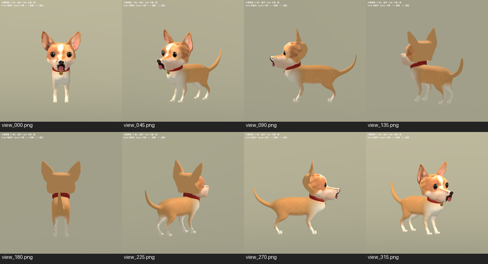

# Chihuahua r38 — 2026-10-14

Delivered to the runtime model and matching Mesh2Motion library. ART assessment: **S / final candidate for normal gameplay camera**, based on the full-direction and motion review, not solely automated checks. This replaces r37's seated-base body with standing anatomy while retaining the Chihuahua face and ears.

## Result

Separated hindquarters and feet, individual toe silhouettes, curved tail, continuous tan/cream coat, red collar and brass tag. Reworked head/neck skin transition and rear skull volume, removed the rear painted zigzag, corrected jaw neutral and replaced duplicate tongue surfaces with one weighted tongue. Retargeting scales joint translations as well as rotations; seated front feet and rear toes now meet the ground.

14,969 triangles; 49 deform bones; seven material surfaces; four strongest normalized skin influences. Twelve embedded clips and nine matching external motion clips. Model and motion library must travel together.

## Evidence

- Godot 4.6.3: breed_models_test 81 checks and dog_motion_test 80 checks PASS after runtime integration.
- Actual evaluated skin: 912 poses across ten unique clips, no nonfinite vertices; minimum ground error approximately -0.035 mm. This measures penetration, not absence of all foot sliding.
- Runtime resource-path loading: 8 directions and 60 sampled poses, matching external bind rest; real DogModelMotion3D playback checked. Runtime stderr empty.
- Direct-candidate and resource-import PNGs are not byte-identical; final review used the runtime images below. No pixel-equivalence claim.
- Python syntax checked for all 22 delivery authoring scripts.

[Idle / Walk / Sit / Run](chihuahua_r38_2026-10-14/contact_motion_0.png) · [Sneak / Fetch / Bark / Alert](chihuahua_r38_2026-10-14/contact_motion_1.png) · [Jump / Howl / Sit / Idle](chihuahua_r38_2026-10-14/contact_motion_2.png)

The Jump apex is cropped by the fixed review camera; full evaluated-skin heights are recorded in the audit. At close inspection the inherited head texture remains soft and rear-head detail simplified. This is a gameplay art candidate, not a cinematic close-up asset. Other dog breeds are outside this delivery.

## Files and rebuild

Runtime: assets/characters/dog/models/breeds/chihuahua.glb and assets/characters/dog/animations/m2m/chihuahua.glb, including Godot-extracted textures. Frozen candidate: assets/art_previews/dogs/candidates/r38/.

Authoritative packed editable source: ../good-human-3d-pipeline/blender/dog/chihuahua_r38_2026-10-14/chihuahua_r38_editable.blend (outside game history). Source/archive hash and runtime hashes: [provenance](chihuahua_r38_2026-10-14/provenance.json).

In Blender 5.2, open the packed source, run tools/art/prepare_chihuahua_delivery_export.py, then tools/art/export_chihuahua_delivery.py. These mutate the working scene; reopen the packed source to repeat. Other delivery scripts are incremental authoring steps, not a validated unattended pipeline. Godot check: --headless --path . --script res://tools/art/check_chihuahua_delivery.gd; visual capture omits --headless and adds -- --runtime. Generate runtime sheets with python tools/art/contact_chihuahua_delivery_godot.py --runtime.

## Provenance and limits

Body/rig/motion adaptation: existing CC0 Mesh2Motion fox by Scott Petrovic, retrieved 2026-10-09 at commit 653a969; originals untouched. Head: existing r37 Chihuahua and project reference. New geometry, painting, skinning and retarget adjustments by GOOD HUMAN! ART via Codex. No new third-party downloads. Inherited factory/Hunyuan/reference restrictions still apply; the entire derivative is not declared CC0 and this delivery does not resolve unknown reference rights.

Machine-readable skin audit, Godot reports, regression outputs and runtime capture logs are in chihuahua_r38_2026-10-14/.
