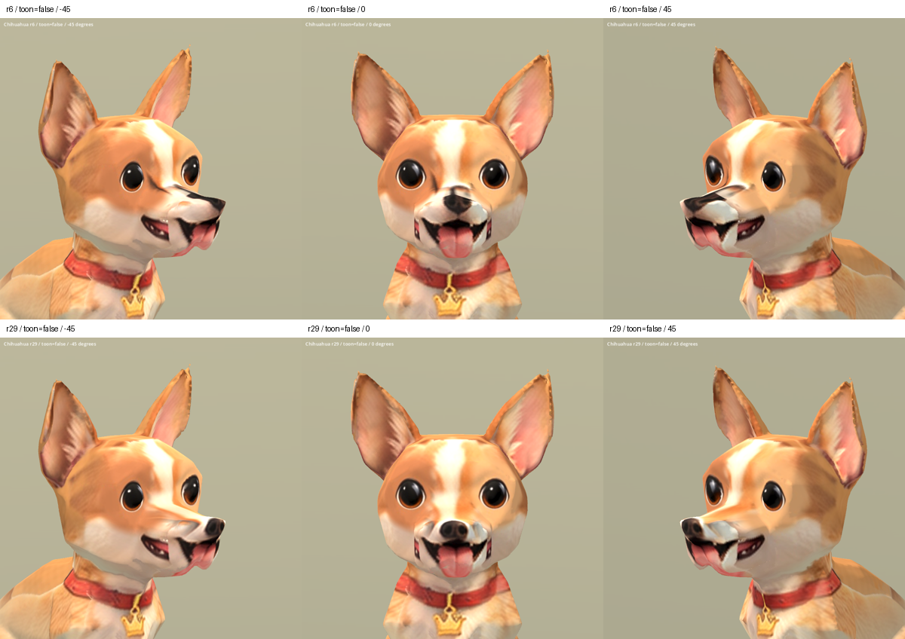

# Chihuahua nose and bridge r29 — 2026-10-08

Status: REVIEW / B. Separate candidate; runtime unchanged.

## Result

Local projection of the owner's Chihuahua front reference removes the long dark nasal-bridge stripe visible in r6 oblique/profile views and registers a compact nose on the tip. Existing eyes and overall facial geometry are retained. The bridge is now light fur instead of a stretched black nose projection.

Remaining defects: side-mouth duplication, muzzle/chin material seams, angular long muzzle geometry, rough ear surfaces, and serious inherited body stretching/front-paw lifting during Sit. The texture correction does not repair these shapes or animations. This is not final/S-level art.

Candidate: `assets/art_previews/dogs/candidates/r29/chihuahua.glb`.
Baseline: `assets/characters/dog/models/breeds/chihuahua.glb` (r6).

## Preservation and source

Only the embedded base-color image is replaced. Original binary buffer is retained exactly as a prefix; accessors, meshes, nodes, skins, animations, materials, textures, samplers and scene descriptors are checked for equality. Original geometry, normals, UVs, weights and Idle/Sit/Walk animation data remain byte-identical.

The complete body atlas is rebaked at 2048 px, so pixels outside the local mask may be resampled rather than identical. The intended edit is confined to the nose/bridge region; this does not claim unchanged image bytes outside that region.

Input: owner's existing factory `references/dogs/chihuahua_front.png`. No new third-party source or generated image. Original factory/Hunyuan-derived weight restrictions remain.

Scripts in `tools/art/`: `material_chihuahua_r29.py`, `bake_chihuahua_r29.py`, `package_chihuahua_r29.py`, `verify_chihuahua_r29.ps1`, `contact_chihuahua_r29.py`.
Material setup expects a fresh r6 import named DogBody. Do not rerun over an already modified shader graph. Temporary Blender snapshots: `chihuahua_r29_00_before.blend`, `chihuahua_r29_01_material.blend`, `chihuahua_r29_02_baked.blend` in the system temporary directory.

## Validation

Blender front and oblique material previews inspected. Godot import and capture exited 0: 20 static comparisons (r6/r29, standard/SoftToon, five angles) and nine Idle/Walk/Sit samples (25%, 50%, 75%). All captured angles and nine animation samples visually inspected. Sit defects remain visible; successful import/capture is not approval of the inherited animation.

Evidence: `build/chihuahua_nose_r29/verification.json`, `import.log`, `capture.log`, `capture_stderr.log`.
Source SHA256: `87eaef8bd9ca42de4731efe36d05091e37200698f06c12f38c76239a4a3fce72`.
Candidate SHA256: `711afcd31f868de3f593bd6e30af8b541e8f47a5146ea28ae4601f35940bfdeb`.

[Profiles](chihuahua_r29_2026-10-08/sides_false.png) · [SoftToon angles](chihuahua_r29_2026-10-08/all_true.png) · [Animation samples](chihuahua_r29_2026-10-08/animations.png)

Next local facial task: resolve duplicate side-mouth projections without repainting the eyes or replacing the whole face.
