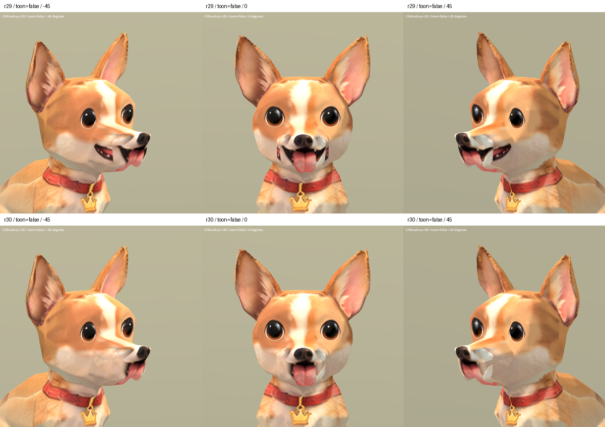

# Chihuahua Ucupaint cheek repair r30 — 2026-10-09

Status: REVIEW / B. Independent candidate; this task did not replace a runtime model.

The duplicate dark side-mouth projection is substantially removed on both cheeks. The front mouth, tongue, eyes and r29 nose remain. Faint patch outlines, pale tooth specks and mismatched cheek color remain at close range. Angular muzzle geometry, seams and severe inherited Sit stretching remain. Not final/S-quality art.

Candidate: `assets/art_previews/dogs/candidates/r30/chihuahua.glb`.
Baseline: `assets/art_previews/dogs/candidates/r29/chihuahua.glb`.

## Plugin workflow

Saved the scene and restarted Blender 5.2.0 LTS. Automatic preference saving was disabled in the old process only, to avoid overwriting the newly installed plugin preferences. After restart Ucupaint, Magic UV, LoopTools, Rigify, Retarget and PolyQuilt were confirmed enabled. No plugin installation/removal.

This pass actually uses Ucupaint layer/mask composition. Magic UV and LoopTools were not invoked because geometry and UVs remain unchanged. The stack contains `R29 preserved base` and `R30 remove duplicate side mouth`, with an independent image mask. Blender emission baking produces donor/mask atlases, then bakes Ucupaint's final Color output to a plain 2048 px PNG for GLB. The script explicitly clears halt_update and reconnects the root nodes so the layers affect the output.

Initial broad masking produced a rejected rectangular pale patch. The final mask also follows dark pixels in the original texture and uses the owner's existing `references/dogs/chihuahua_side.png` for cheek fur. Residual outlines and tooth specks remain. No new external asset; inherited factory/Hunyuan-derived rig restrictions remain.

Editable packed file: `../good-human-3d-pipeline/blender/dog/chihuahua_r30/chihuahua_r30_ucupaint.blend` (32,146,841 bytes).
Scripts in `tools/art/`: `build_chihuahua_r30.py`, `bake_chihuahua_r30.py`, `package_chihuahua_r30.py`, `verify_chihuahua_r30.ps1`, `contact_chihuahua_r30.py`. The builder backs up the scene and imports fresh r29 geometry. Untouched sources are retained.

## Validation

- Blender oblique previews inspected during iteration.
- Final Godot import/capture exited 0: 20 static comparisons and nine Idle/Walk/Sit samples. Standard and SoftToon front/oblique/profile captures and all animation samples inspected. Existing Sit defects remain.
- Published model test `tests/breed_models_test.tscn`: PASS, 81 checks.
- Candidate test `tools/art/check_chihuahua_r30.tscn`: PASS, 10 checks, reusing the existing `_check_model` implementation. An initial UTF-8 BOM parse failure was corrected before the passing rerun.
- Original binary buffer retained as an exact prefix. Geometry, UVs, normals, weights and animation data retained; mesh/accessor/node/skin/animation/material/texture/sampler/scene descriptors checked unchanged. Only the base-color image is replaced.
- Full-atlas rebaking may resample pixels outside the intended edit; those image bytes are not claimed identical.

Evidence: `build/chihuahua_mouth_r30/plugin_workflow.json`, `verification.json`, `capture.log`, `breed_test.log`, `candidate_test.log`.
Source SHA256: `711afcd31f868de3f593bd6e30af8b541e8f47a5146ea28ae4601f35940bfdeb`.
Candidate SHA256: `9c2067617bb4daa6182c973437902aebacaa9ab63e72ffd037e413d62e829e97`.

[Profiles](chihuahua_r30_2026-10-09/sides_false.png) · [SoftToon angles](chihuahua_r30_2026-10-09/all_true.png) · [Animation samples](chihuahua_r30_2026-10-09/animations.png)
