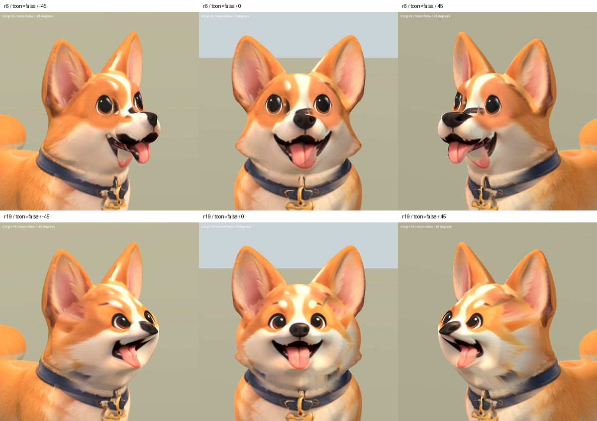

# 柯基整臉修復試作 r19 — 2026-10-06

狀態：REJECTED。主人指出整體比原版更差；簡化曲面破壞原口鼻體積，
側面投影拉伸，新舊臉未接順。停止以此版為基礎修補；r20 改回原 r6。
主人要求先換下一隻狗；本輪選柯基，處理重複鼻口、鼻樑黑色投影及下巴殘留嘴形。

## 實作與外觀結論

從 runtime r6 保存不可覆寫來源 `candidates/r19/corgi_r6.glb`，使用主人既有
`good_human_stylized_factory/references/dogs/corgi_front.png` 重建連續前臉。
眼睛也隨整臉改為原設定圖眼形，不是保留 r6 眼睛的純貼圖修正。

鼻口不再由數個互相衝突的投影碎片組成，正面嘴形較完整。多輪 Blender
比較後，縮小額頭切口，調整舌頭深度並排除參考圖背景及項圈。
但新舊額頭接縫、額側耳色拉伸、頰部與下巴交界仍明顯；側面口腔的立體感
也不足。本輪只形成下一步可修的候選，不能宣稱整隻柯基已修好。

## 數據

- 原模型高度 0.45 m；依柯基重新量測，不沿用法鬥臉型數值。
- 移除 6,547 個舊前臉三角形，單一切口環 205 點。
- 新前臉 4,511 頂點 / 8,815 三角形；總計 50,244 三角形，仍高於目標。
- 原骨架 nodes、joint list、bind matrices 及 Idle/Walk/Sit 動畫資料一致。
- 新前臉中央綁定 head、邊界混合原權重；不能宣稱所有蒙皮權重未變。
- 有限值、權重和、骨骼索引、法線長度檢查通過；無退化三角形。
- 本輪無新增第三方來源，保留原 breed factory / inherited rig 授權限制。

來源 SHA256：`e97af26d5d882f5982bcb82f65d998ee09105e03789b326db4bef39cd0155f97`

候選 SHA256：`84c32ad08d4e265a90f37636d09b9c8e4f67b55987b7c41a8f302e44a48eee67`

候選：`assets/art_previews/dogs/candidates/r19/corgi.glb`。
Blender 備份：TEMP `corgi_r19_00_original.blend`、`corgi_r19_review.blend`。
腳本：`tools/art/rebuild_corgi_face_r19.py`、`review_corgi_r19.py`、
`validate_corgi_r19.py`、`verify_corgi_r19.ps1`、`contact_corgi_r19.py`。
數據與原始画面：`build/corgi_face_r19/`。

## 前後比較

Godot 完成 29 張擷取（兩材質五角度新舊比較、三動作各三時點），程序
退出碼 0、錯誤日誌空白。已查看正斜面、左右側面及動畫總覽。
側面確認新口鼻輪廓過尖、面部深度不足，也是下一輪必須修正的問題；
既有 Sit 軀幹及腿部變形仍在。以上不能因骨架數據通過而視為驗收成功。

上排原 r6，下排 r19 試作；同角度、燈光與材質。

[左右側面](corgi_r19_2026-10-06/sides_false.png) ·
[SoftToon](corgi_r19_2026-10-06/face_true.png) ·
[動畫取樣](corgi_r19_2026-10-06/animations.png)
