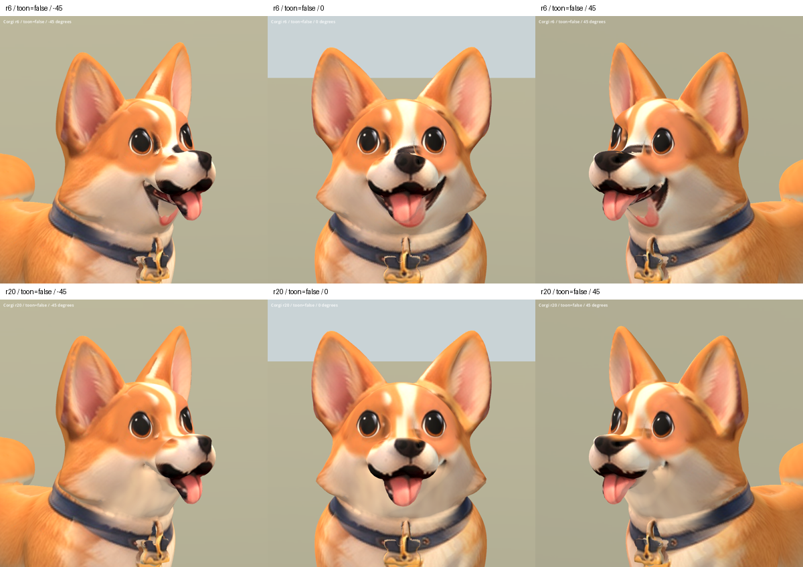

# 柯基局部貼圖修復 r20 — 2026-10-06

狀態：REVIEW / B。依主人對 r19 退步的指正，放棄整臉替換，回到原 r6。
保留原頭型、鼻樑、嘴墊、舌頭及下顎的所有幾何資料。遊戲版未替換。

## 實際修改

1. 鼻樑重複黑色鼻投影：按高度、寬度及前後位置限定局部覆蓋；素材取自
   主人既有柯基正面圖的鼻樑毛色。第一輪碰到鼻頭上緣，已收窄深度遮罩。
2. 下巴重複嘴形／第二條舌頭：在真正舌頭後方的下巴區域，用同一設定圖
   淺色頰毛投影覆蓋。並非剪掉模型的嘴部，也沒有移動舌頭。

嘴角過渡與淺色下巴仍偏平，鼻樑留有色差；原本嘴墊下緣黑色區及眼緣
瑕疵仍可見，尚未达到最終品質。r20 是局部清除重複投影的候選，並非
整臉修復或 S 級驗收。

## 資料驗證

`validate_corgi_r20.py` 確認：原 r6 完整二進位資料原封保留；meshes、
accessors、nodes、skins、animations、materials、textures、samplers、scenes
JSON 完全一致。只追加新的 base-color PNG 並將嵌入圖片指向它。
頂點、法線、UV、拓撲、骨架、權重與動畫均不變。

原 r6 的 Sit 變形與模型品質限制仍在。材質由 Blender 烘焙，輸出 PNG
為 2048²；重新取樣會影響貼圖其餘區域的像素值，不能宣稱未修區像素完全一致。

候選：`assets/art_previews/dogs/candidates/r20/corgi.glb`

SHA256：`18fc823b640a6ddc9a749f51d1bb5a9b9cfec7fcd4efed52ad36a99e01fe9872`

來源：保留的 `candidates/r19/corgi_r6.glb` 與既有 `corgi_front.png`。
無新增第三方素材，沿用 breed factory 及 inherited rig 授權限制。

工具：`tools/art/bake_corgi_r20.py`（Blender）、`package_corgi_r20.py`、
`validate_corgi_r20.py`、`verify_corgi_r20.ps1`、`contact_corgi_r20.py`。
數據／烘焙／原始擷取：`build/corgi_face_r20/`。
Blender 里程碑：TEMP `corgi_r20_00_before.blend`、`corgi_r20_01_side_material.blend`、
`corgi_r20_02_baked.blend`。原 r6 模型與之前原始 Blender 備份均保留。

## 比較

Blender 五角度渲染完成並檢視正面與左右斜側。最終 GLB 在 Godot 完成
29 張擷取（兩材質五角度前後、Idle/Walk/Sit 各三時點），程序退出碼 0。
實際查看一般材質正斜面、左右側面及動畫總覽；下巴殘影已去除，但側面
嘴角露出的淺色薄面與接合仍不自然，需要後續局部幾何／口腔材質處理。

上排 r6，下排 r20，使用同攝影機、燈光與材質。

[左右側面](corgi_r20_2026-10-06/sides_false.png) ·
[SoftToon](corgi_r20_2026-10-06/face_true.png) ·
[動畫](corgi_r20_2026-10-06/animations.png)
