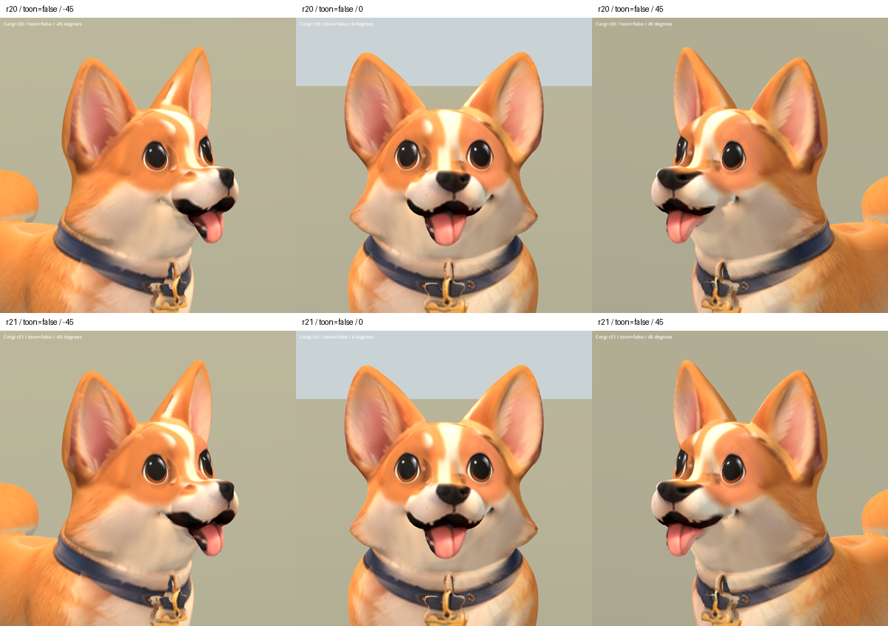

# 柯基嘴角材質 r21 — 2026-10-06

狀態：REVIEW / B，僅局部材質調整。保留 r20 頭型與鼻樑／下巴投影修復，
在嘴墊下緣後方加上受限的深棕口腔色，改善嘴角淺色接面上緣的連接。

第一輪色域過大，在侧面成為孤立黑斑，已撤回；最終把區域上移、縮窄，
限制在嘴墊下緣。改善幅度小：舌頭後方仍有淺色薄面，嘴角幾何尚不自然。
不能把這版視為已修好口腔，也未替換遊戲版本。

## 資料及來源

- 所有原 r6 二進位資料保留。mesh/accessor/nodes/skins/animations 及材質、
  sampler JSON 相同；只追加 base-color PNG。頂點、UV、法線與權重完全未變。
- 延用 r20 的既有柯基設定圖，口腔色由 Blender 材質節點設定；無新增第三方素材。
- 來源與 inherited rig 授權限制不變，整體仍為 B 級。
- 候選：`assets/art_previews/dogs/candidates/r21/corgi.glb`。
- SHA256：`6b14a2658677873a7f31d80e3123bd8eac36cdaf81dc61983a7145ea73ab6a43`。
- 工具：`tools/art/bake_corgi_r21.py`、`package_corgi_r21.py`、
  `validate_corgi_r21.py`、`verify_corgi_r21.ps1`、`contact_corgi_r21.py`。
- 中間資料與渲染：`build/corgi_face_r21/`；Blender 材質與烘焙里程碑
  在 TEMP 的 `corgi_r21_*.blend`。

## 比較

Blender 五角度已渲染並檢視正面、斜側及左側面。Godot 最終完成 29 張
擷取：两材質五角度 r20/r21 比較，以及 Idle/Walk/Sit 各三時點；退出碼 0。
已查看一般材質正斜面、左右側面及動畫總覽。側面確認改善僅限嘴墊下緣，
下方淺色薄面仍在；既有 Sit 變形不變。

上排 r20，下排 r21。

[左右側面](corgi_r21_2026-10-06/sides_false.png) ·
[動畫](corgi_r21_2026-10-06/animations.png)
