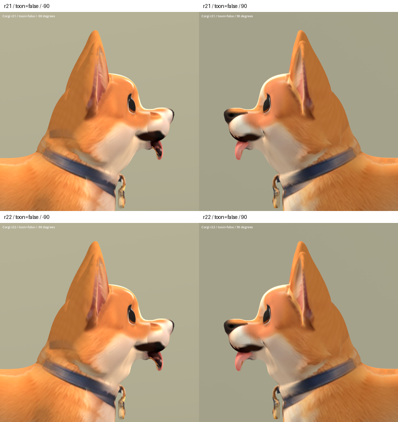

# 柯基舌根接面 r22 — 2026-10-06

REJECTED：Godot 斜側及動畫畫面顯示下巴出現新的方形凹陷高光，整體不比
r21 更好，不採用此版，保留 r21。灰模確認淺色薄面是舌根後方與下巴連接的
曲面，不只是貼圖。沿用 r21 材質，在限定的嘴部區域向後回縮並微幅抬升，
使突出接面較收斂；薄面並未完全消失，仍不能視為自然完整的口腔。

Godot 完成 29 張擷取並檢視側面、正斜面及動畫總覽，程序退出碼 0。
失敗原因是只推回局部頂點使下巴曲率出現凹坑；沒有真正重建舌根與內口腔
的拓撲關係。後續應以明确嘴部邊界重建局部內口腔，而非持續加大位移。

第一輪最大約 22 mm 的回縮造成下巴凹陷，已撤回。最終 773 個邏輯頂點
移動，最大 5.57 mm；保留所有水平座標、前方舌尖、鼻口上部及區域外位置。
拓撲、UV、貼圖、蒙皮權重、骨架與動畫資料保留；局部法線重算。

驗證：47,976 三角形、零退化面、法線與權重有效；骨架 nodes/bind matrices
及動畫 channels/keyframes/interpolation 與來源相同。

候選：`assets/art_previews/dogs/candidates/r22/corgi.glb`。
SHA256：`155162a79ee3c776cf4113bb7e3e4a278bd700a079da2f20f8401938b4825ae7`。
遊戲未替換。無新素材或授權變更，沿用 breed factory / inherited rig 限制。

重現工具：`tools/art/reshape_corgi_mouth_r22.py`、`review_corgi_r22.py`、
`validate_corgi_r22.py`、`verify_corgi_r22.ps1`、`contact_corgi_r22.py`。
數據／渲染：`build/corgi_face_r22/`。Blender 備份及候選在 TEMP
`corgi_r22_00_before.blend`、`corgi_r22_review.blend`。

上排 r21，下排 r22。

[正面與斜側](corgi_r22_2026-10-06/face_false.png) ·
[動畫取樣](corgi_r22_2026-10-06/animations.png)
