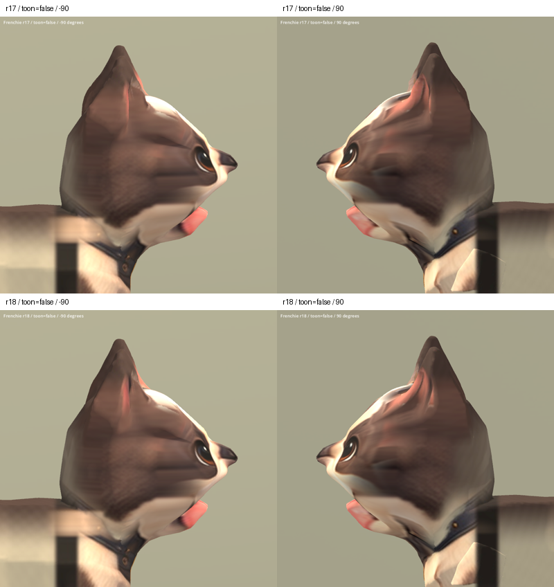

# 法鬥耳根曲面 r18 — 2026-10-06

狀態：REVIEW / B。接續 r17，針對耳根及額側局部曲面的深度起伏做平滑。
灰模確認部分橫向痕跡來自幾何；本輪不重畫貼圖。局部凹凸減輕，但額側
較大的褶線、耳內粗糙表面及材質色帶仍未完全修復。未替換遊戲中的法鬥。

## 變更

以共用邏輯頂點的鄰接關係平滑深度，保留所有頂點的正面 X/Y 座標。
限制作用高度與左右位置，保護眼鼻嘴、下臉與耳尖。重算法線。
第一輪範圍太廣，側面耳朵變薄，已撤回；最終版本降低迭代次數，縮小
上緣範圍，並以平滑函數限制深度位移在 8 mm 內。

- 2,554 個邏輯頂點移動，最大位移 7.90 mm。
- 全模型正面 X/Y 座標完全一致；高度 ≤ .752（模型正規化座標）的
  眼鼻嘴及下臉三維位置完全不變。
- UV、嵌入貼圖 bytes、joint indices、weights 與 r17 一致。
- 原 r6 骨架節點、bind matrices、動畫 channels/keyframes/interpolation 一致。
- 46,016 三角形，無退化三角形；有限值、權重與法線檢查通過。

## 輸出

Blender 五角度與左右灰模已渲染，實際檢視正面、左右側面及右側灰模。
Godot 完成 29 張擷取：两種材質、五角度新舊比較，另加 Idle/Walk/Sit
各 25/50/75% 取樣。已檢視側面比較、SoftToon 正斜面及動畫總覽；
擷取日誌正常結束、錯誤日誌為空。Sit 的既有明顯變形仍在。

候選：`assets/art_previews/dogs/candidates/r18/frenchie.glb`

SHA256：`68ed47878aa6f348dcbb46c225ad64e3d1608443ed52991029dcb1ffdd6b65d0`

腳本：`tools/art/smooth_frenchie_ear_r18.py`、`review_frenchie_r18.py`、
`validate_frenchie_r18.py`、`verify_frenchie_r18.ps1`、`contact_frenchie_r18.py`。
原始畫面及日誌：`build/frenchie_face_r18/`。Blender 備份及幾何里程碑
在 TEMP 的 `frenchie_r18_00_before.blend`、`frenchie_r18_01_geometry.blend`。

本輪沿用既有素材，無新增第三方來源。整體仍為 B 級；既有 Sit 變形、
身體造型與超額面數仍待處理。

上排 r17，下排 r18；同角度、燈光及材質。

[五角度](frenchie_r18_2026-10-06/all_false.png) ·
[正面及斜側](frenchie_r18_2026-10-06/face_true.png) ·
[動畫](frenchie_r18_2026-10-06/animations.png)
