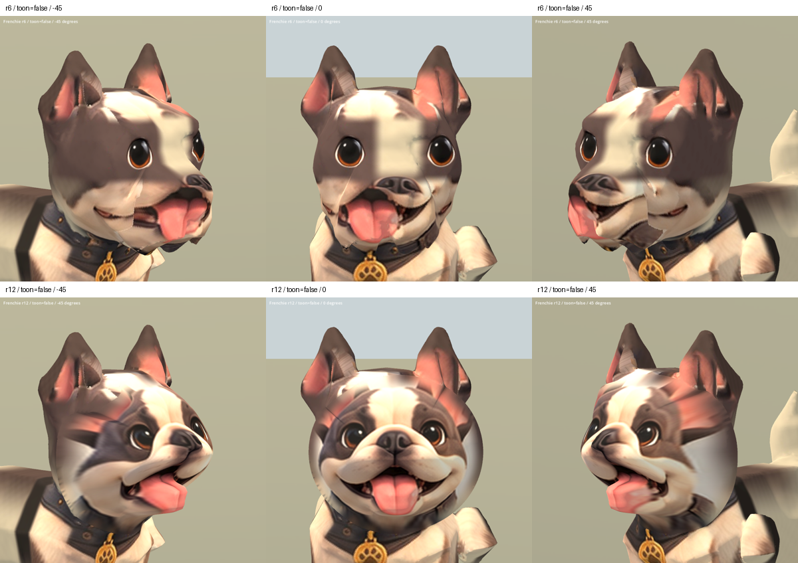

# 法鬥臉部修復 r12 — 2026-10-05

承接 r11，擴大嘴角與下巴的整臉切口，清除切口內殘留的嘴部網格小島。
重建邊界為單一連續環（209 點），下巴斜側面的薄片與重複嘴角已改善。
調低切口中心以保留額頭範圍；保留原骨架與三段動畫。

- 狀態：REVIEW / B，獨立候選，runtime 法鬥仍為 r6。
- 候選：`assets/art_previews/dogs/candidates/r12/frenchie.glb`
- 原始基線：`assets/art_previews/dogs/candidates/r11/frenchie_r6.glb`，未覆寫。
- SHA256：`870c63f0b044c8931399ef849a4bf7f35f8780266297bdc864c84b4e4d4f3708`
- 共 46,016 三角形；移除 10,331 個舊面，新增 8,151 個臉部面。
- 重建：`tools/art/rebuild_frenchie_face_r12.py`。共用引擎新增可選的小島清除，舊配方預設不啟用。
- 驗證：`tools/art/validate_frenchie_r12.py`、`verify_frenchie_r12.ps1`。

## 實際驗證

Blender 已渲染正面、左右 45°、左右側面。修改前與修改後的 `.blend`
保存於本機 TEMP 的 `frenchie_r12_01_before.blend`、`frenchie_r12_04_final.blend`。
Godot 完成 20 張前後對照（五角度 × 兩材質 × 兩版本）及 9 張動畫取樣。
Idle、Walk、Sit 各檢查 25%、50%、75%；取樣成功不代表原有動畫品質合格。
數值檢查確認骨架節點、bind matrices、動畫 channels、keyframes、interpolation
與 r6 一致；權重正規化、joint index 有效、無退化三角形，法線長度正常。
原始結果與日誌在 `build/frenchie_face_r12/`。

第一次沙盒內截圖因使用者日誌存取錯誤後崩潰；取得執行權限後重跑成功。

## 待修問題

耳根與側額仍有粉紅色貼圖拉伸和接縫；側面眼睛仍受正面投影影響。
舌頭厚度與口腔側面不夠自然；身體、耳內、項圈與 Sit 的既有變形未修。
46k 面仍高於狗角色目標，不是 S 級完成品，尚未替換 runtime。
無新增第三方素材；沿用原主人法鬥設定圖、r6 來源與既有授權鏈。

[五角度 SoftToon](frenchie_r12_2026-10-05/all_true.png) ·
[動畫取樣](frenchie_r12_2026-10-05/animations.png)
