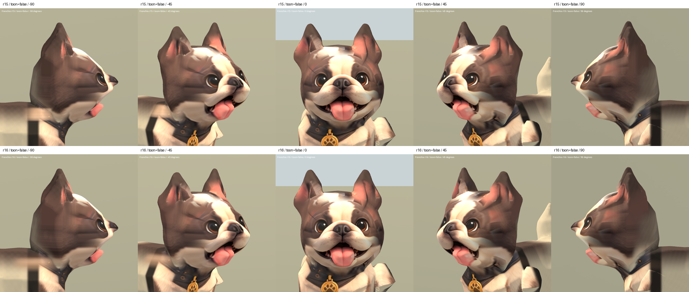

# 法鬥材質修復試作 r16 — 2026-10-05

結果：REJECTED。承接 r15，嘗試縮小側面毛色參考取樣區域，並把側面投影
向後延伸。Godot 同角度比較顯示左側出現更明顯的大片均勻棕色色塊，
額側橫向拉伸、耳根粉紅殘影仍存在，未達到可接受的改善。不替換 r15，
不更新遊戲中的法鬥。

## 本輪實作與發現

- 使用原有側面設定圖，把橫向取樣上界 265 調至 235、縱向下界 220 調至 235，
  避開耳緣；投影後端淡出範圍由 -.035/.055 改為 .04/.12。
- 試過提高耳權重遮罩起點，但會遮掉正常耳內粉紅色，因此撤回。
- 這類夾限取樣會把狹窄毛色區拉成大片色塊，不能作為後續修復方案。
  下一輪應針對耳根及額側做獨立、連續的 UV 對應，保留完整耳內形狀，
  而非繼續擴大目前的平面投影範圍。

## 驗證

- Blender 五角度渲染完成；查看側面後迭代兩次。
- Godot 29 張擷取完成：兩種材質、五角度新舊比較，以及 Idle/Walk/Sit
  各 25/50/75% 取樣；已查看一般材質比較、SoftToon 正斜面、動畫總覽。
- r15 每三角形角點的位置、法線、骨骼索引及權重完全一致。
- 原 r6 骨架節點、bind matrices、動畫 channels/keyframes/interpolation 保留。
- 46,016 三角形；無退化三角形，權重及法線檢查通過。
- 原有 Sit 明顯拉伸及身體造型問題仍在；技術驗證通過不代表外觀通過。

試作：`assets/art_previews/dogs/candidates/r16/frenchie.glb`（拒用，僅保留比較）。
SHA256：`9840c7c50dc2e1162ebf256537153f0cb84805901d4753e31e90fc73a00b7ffe`。
來源及授權沿用 r15，無新增第三方輸入。

重現：`tools/art/bake_frenchie_r16.py` → `package_frenchie_r16.py` →
`validate_frenchie_r16.py` → `verify_frenchie_r16.ps1` → `contact_frenchie_r16.py`。
日誌、烘焙及原始畫面在 `build/frenchie_face_r16/`；Blender 里程碑保存在 TEMP。

[SoftToon](frenchie_r16_2026-10-05/face_true.png) · [動畫](frenchie_r16_2026-10-05/animations.png)
