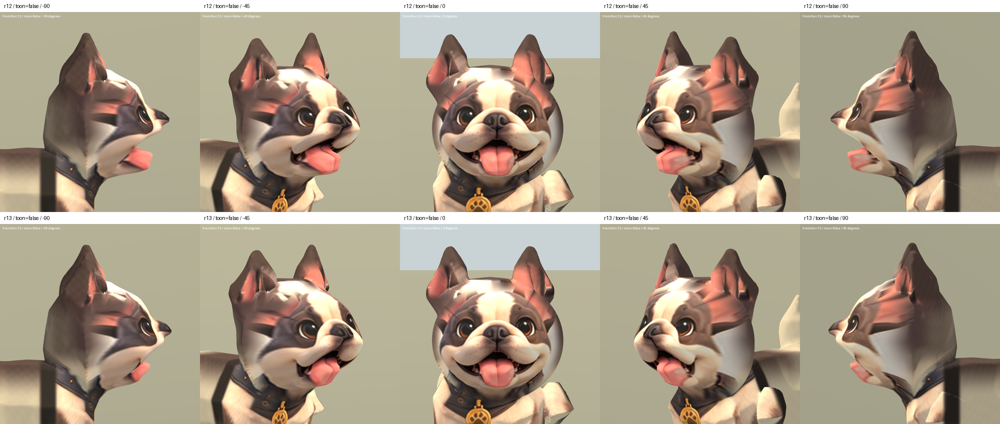

# 法鬥側面調整 r13 — 2026-10-05

主人認可 r12 正面，要求繼續調整側面。本版保留全部頂點的正面投影座標
（glTF X/Y 數值與 r12 完全相同），只調整臉部深度與局部額側貼圖混合。
正面光影會隨深度改變，並非逐像素相同。

舌頭縮回，減少側面厚塊感；填順嘴角至臉頰過深的凹陷，微調眉額到短口鼻的過渡。
第一輪收縮過多，側面口腔幾乎被臉頰遮住，故第二輪減弱位移，保留部分舌頭露出。
耳根粉紅拉伸仍明顯，貼圖混合只帶來局部改善，不能視為已解決。

- 候選：`assets/art_previews/dogs/candidates/r13/frenchie.glb`
- SHA256：`9d836e3379bb2d949f63b2c7b12d65a245f42bbfc0283a1d76e55c0fab7d8070`
- 配方：`tools/art/rebuild_frenchie_face_r13.py`
- 驗證：`tools/art/validate_frenchie_r13.py`、`verify_frenchie_r13.ps1`
- 46,016 triangles；原 r6 骨架、bind matrices、動畫 channels/keyframes/interpolation 不變。
- 正面座標不變、權重/法線/有限值/退化面檢查通過。
- Blender 正面、±45°、±90° 實際渲染並檢視。
- Godot 29 張：r12/r13 五角度、兩材質，以及 Idle/Walk/Sit 各 25/50/75%。
- Blender 備份：本機 TEMP `frenchie_r13_00_before.blend`；最終候選 `frenchie_r13_02_profile.blend`。
- 原始截圖、資料檢查與執行日誌：`build/frenchie_face_r13/`。

仍為 REVIEW / B；側面眼睛與口腔仍受正面投影限制、耳根貼圖與 Sit 既有變形仍待修。
沒有新增第三方資產，延續 r12 來源與授權。尚未替換 runtime 法鬥。

[正面及 45° SoftToon](frenchie_r13_2026-10-05/face_true.png) ·
[動畫取樣](frenchie_r13_2026-10-05/animations.png)
