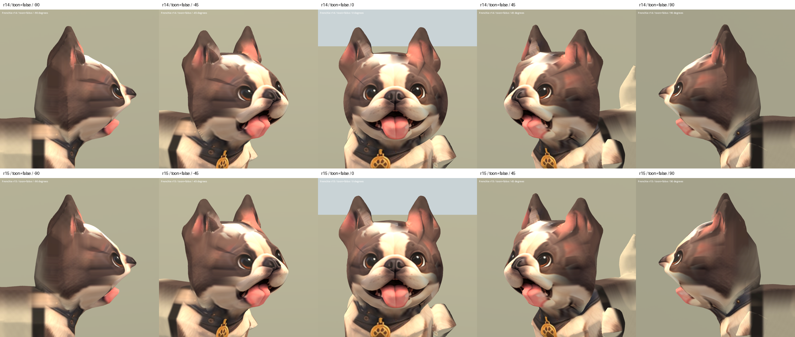

# 法鬥交界曲面修復 r15 — 2026-10-05

承接主人要求繼續處理側臉貼皮感。本輪先用灰模隔離材質，確認 r14 的垂直
鋸齒邊確實存在於曲面，並非只靠改毛色能消除。針對新舊網格共用的 209 個
邊界位置及附近網格做局部平滑，統一邊界法線，再重新展 UV、烘焙側面材質。

## 改善

側臉接到後腦的鋸齒狀硬邊已明顯接順。額側另做深度平滑，保留中央正面
投影座標；眼鼻嘴所在核心區的完整位置未動。共調整 2,369 個邏輯頂點，
最大位移 17.7 mm，範圍限制在臉部交界和額側。

第一次平滑後舊烘焙貼圖露出黑色小三角；重新以修整後幾何展 UV、從原始
r13 材質與側面設定圖重新烘焙後清除，未用塗黑或雙面材質遮掩。

仍為 REVIEW / B：額側殘留的褶線與色帶、耳內粗糙表面、嘴部側面深度、
既有 Sit 變形與 46,016 面的超額面數尚未達到 S 級。r15 是改善交界的候選，
尚未替換 runtime 法鬥。

## 驗證與檔案

- 候選：`assets/art_previews/dogs/candidates/r15/frenchie.glb`
- SHA256：`f936c04c412be64ca06b8986c2b73ef200b687507cd4bef2da2d5d7b6169cd45`
- 原始來源 r14 不覆寫；新材質仍取自既有正面、側面設定圖，無新增第三方來源。
- 骨架節點、bind matrices、動畫 channels/keyframes/interpolation 與 r6 相同。
- 每三角形角點的 joint/weight 資料與 r14 一致；權重和、法線及有限值檢查通過，
  無退化三角形。UV 重排會拆分頂點，不能宣稱整份幾何 buffer byte-identical。
- 中央臉部正面 X/Y 座標與 r14 完全一致；核心區且高度 ≤ .752 的眼鼻嘴位置完全一致。
- Blender 五角度及灰模側面檢查；Godot 29 張截圖涵蓋五角度、兩材質及
  Idle/Walk/Sit 各 25/50/75%。動畫取樣成功不等於繼承的 Sit 品質合格。
- `.blend` 備份與里程碑在本機 TEMP：`frenchie_r15_00_before.blend`、
  `frenchie_r15_01_smooth.blend`、`frenchie_r15_02_baked.blend`、`frenchie_r15_03_glb.blend`。

重現順序：

1. `tools/art/smooth_frenchie_seam_r15.py`
2. `tools/art/frenchie_r15_bake_source.py`
3. Blender 執行 `tools/art/bake_frenchie_r15.py`
4. `tools/art/package_frenchie_r15.py`
5. `tools/art/validate_frenchie_r15.py`、`verify_frenchie_r15.ps1`

數據、日誌與原始畫面在 `build/frenchie_face_r15/`。

[正面及斜側 SoftToon](frenchie_r15_2026-10-05/face_true.png) ·
[動畫取樣](frenchie_r15_2026-10-05/animations.png)
