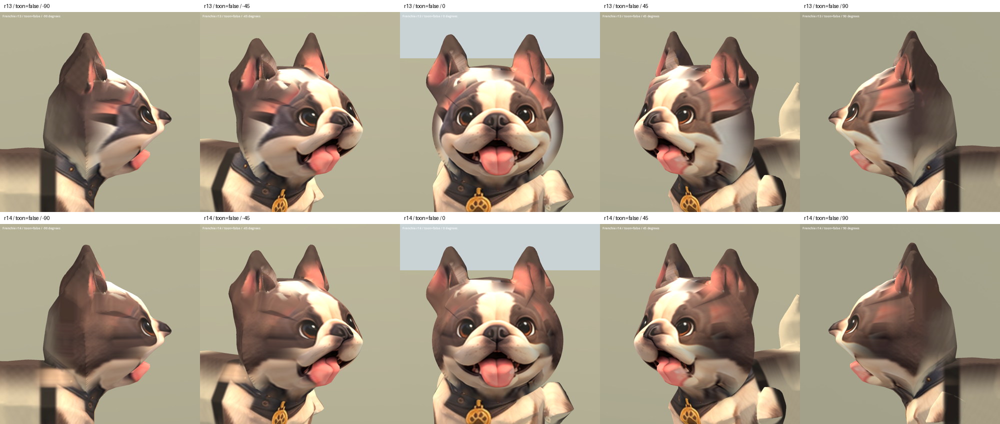

# 法鬥側面材質 r14 — 2026-10-05

主人指出側面顏色像貼上一片臉皮。本輪改用原有側面設定圖的毛色投影，
跨越新臉與保留頭部共用同一材質混合場，再以 Blender emission bake 寫回貼圖。
耳部依骨骼權重及高度保護；眼、鼻、嘴中央保留正面來源。
沒有以新生成的正面圖取代主人認可的五官。

## 結果與限制

側面大片淺色三角區及粉紅拉伸減少，棕色毛區延續到後腦。
但左側臉片邊界仍有明顯硬折線，額側仍有殘餘色帶及舊幾何陰影。
因此仍為 REVIEW / B，不能宣稱「貼皮感」完全消除。
正面五官位置、全模型形狀不變；兩側臉頰毛色比 r13 深，正面並非像素不變。
Sit 舊變形與 46,016 面的超額面數仍在，runtime 未替換。

檢視時曾懷疑後腦、項圈硬邊由烘焙造成；回看 r13 的左側圖，原本即有後腦
直線及肩部黑色矩形，不能歸因為本輪新增。另做了 body UV 重新展開以排除
舊 UV 烘焙重疊風險，但這不會消除既有網格折線。

## 檔案與重現

- 候選：`assets/art_previews/dogs/candidates/r14/frenchie.glb`
- SHA256：`a85812db2e6632888aa790c6b6b602cae43625a7259f46f67d23dcb1ad680eee`
- 原始側面來源：`../good_human_stylized_factory/references/dogs/frenchie_side.png`
- Blender 材質：`tools/art/frenchie_side_material_r14.py`
- 新 UV：`tools/art/unwrap_frenchie_r14.py`
- 原生材質烘焙：`tools/art/bake_frenchie_r14.py`
- 封裝：`tools/art/package_frenchie_r14.py`
- 驗證：`tools/art/validate_frenchie_r14.py`、`verify_frenchie_r14.ps1`
- 本機 TEMP 保存 `frenchie_r14_00_before.blend`、`frenchie_r14_01_side_material.blend`、
  `frenchie_r14_02_baked.blend`、`frenchie_r14_03_glb.blend`。

重現順序：Blender 材質腳本 → UV 展開 → bake → Python 封裝 → 驗證。
UV 重排會拆分必要的頂點，封裝後合併屬性完全相同者。逐三角形角點比較確認
POSITION、NORMAL、JOINTS_0、WEIGHTS_0 與 r13 完全相同；骨架及動畫資料與 r6
一致。修改的是 body UV 與兩張 base-color 貼圖，沒有改形狀或重新匯出動畫。

Blender 實際檢視五角度；Godot 完成 29 張截圖：r13/r14 五角度、兩種材質，
Idle/Walk/Sit 各 25/50/75%。結果在 `build/frenchie_face_r14/`。
使用既有主人設定圖，無新增第三方素材，沿用原授權鏈。

[正面及斜側 SoftToon](frenchie_r14_2026-10-05/face_true.png) ·
[動畫取樣](frenchie_r14_2026-10-05/animations.png)
