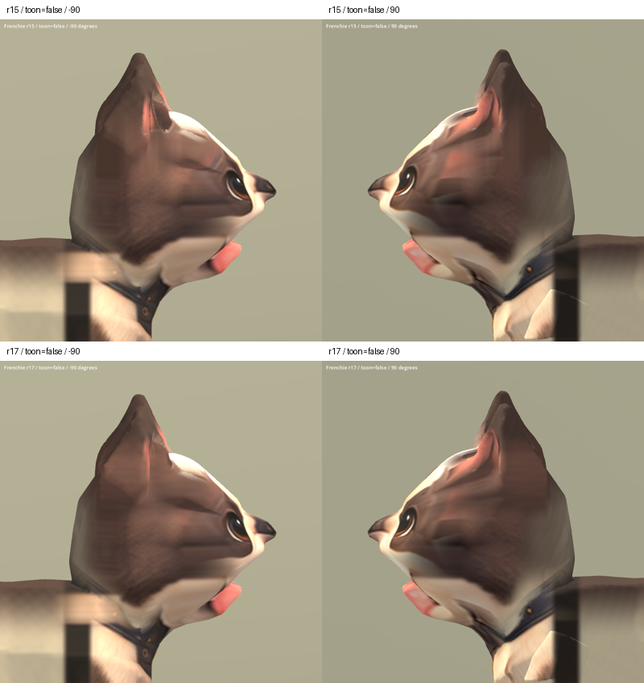

# 法鬥額側材質 r17 — 2026-10-06

狀態：REVIEW / B，局部改善候選。從 r15 延續，跳過已拒用的 r16。
額側粉紅殘影減淡，但耳根仍有橫向紋路、色帶及粗糙造型，尚未完全修復。
保留候選供主人比較，未替換遊戲中的法鬥。

## 變更

在 r15 已烘焙材質上加入獨立的額側投影，使用既有 Frenchie 側面設定圖。
新座標在局部表面連續變化，不使用 r16 會把邊緣像素拉成色塊的座標夾限。
以高度、左右位置、表面法線方向與前後位置控制過渡，降低正面五官受到影響。
重新展開身體 UV 並烘焙材質；模型形狀未改。

## 驗證及限制

- Blender 五角度渲染；實際查看正面及左右側面。
- Godot 29 張畫面完成：r15/r17、五角度、一般與 SoftToon 材質，以及
  Idle/Walk/Sit 各 25/50/75% 取樣。已查看比較總覽、SoftToon 正斜面及動畫總覽。
- r15 每三角形角點的位置、法線、joint indices、weights 完全一致。
- r6 骨架節點、bind matrices、動畫 channels/keyframes/interpolation 完全一致。
- 46,016 三角形；無退化三角形，法線長度及權重檢查通過。
- 骨架資料正確保留不代表動畫品質合格；既有 Sit 拉伸、身體及耳部問題仍在。
- 耳根材質仍不自然，正面耳內原有粗糙表面仍在；不列為 S 級或最終修復。

## 交付

候選：`assets/art_previews/dogs/candidates/r17/frenchie.glb`

SHA256：`b57075d087081b5805ee31f2c949169c2de71a1848e3c624edd86fa45206b8d4`

重現順序：Blender 執行 `tools/art/bake_frenchie_r17.py`，接著
`package_frenchie_r17.py`、`validate_frenchie_r17.py`、`verify_frenchie_r17.ps1`、
`contact_frenchie_r17.py`。原始輸出與日誌：`build/frenchie_face_r17/`。
Blender 備份及材質、烘焙里程碑保存在 TEMP 的 `frenchie_r17_*.blend`。
無新增第三方來源，授權限制沿用原 breed factory。

上排 r15，下排 r17；同一攝影機、燈光與材質設定。

[五角度](frenchie_r17_2026-10-06/all_false.png) ·
[SoftToon 正面及斜側](frenchie_r17_2026-10-06/face_true.png) ·
[動畫](frenchie_r17_2026-10-06/animations.png)
