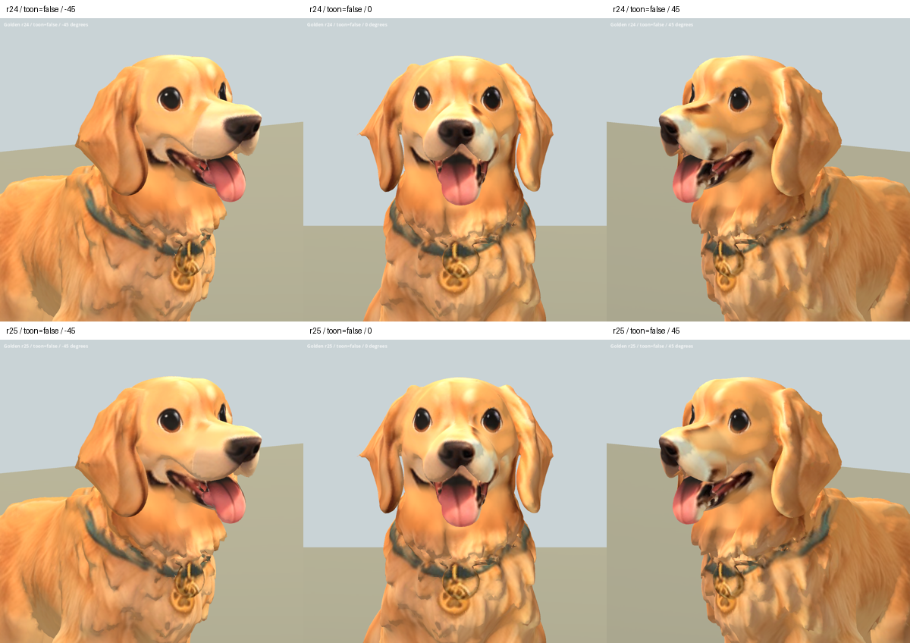

# 黃金獵犬鼻樑 r25 — 2026-10-07

REVIEW / B。接續 r24 下顎清理，局部淡化鼻樑上原有深褐色投影殘影。
保留原長口鼻輪廓、鼻頭、垂耳及原骨架。仍是局部材質候選，不替換遊戲。

使用既有主人 Golden 正面參考的鼻樑毛色，依高度、深度及左右位置混合。
第一輪取樣太寬碰到參考眼色，已縮窄取樣；第二輪遮罩接近眼框，已收窄
高度上緣。保留 r24 的下顎重複嘴形清理。鼻樑補色仍偏平，鼻頭與嘴墊
交界色塊、嘴角碎面及身體毛簇問題尚未修好。

## 驗證與交付

Blender 五角度渲染完成；實際檢視正面、斜側及側面並迭代遮罩。
Godot 29 張擷取完成（雙材質五角度前後、三動作各三時點），程序退出碼 0。
已檢視一般材質正斜面、左右側面及動畫總覽；深色殘影減淡而非全消，
既有 Sit 變形仍存在。骨架資料保留不代表動作品質合格。

- 原始二進位資料、mesh/accessor/nodes/skins/animations/materials/textures/
  samplers/scenes JSON 保留，只有 base-color 圖片替換。
- 幾何、UV、法線、拓撲、權重、骨架、動畫資料均不變。
- 圖片整體重新烘焙至 PNG，未修改區也可能有重新取樣差異。
- 候選：`assets/art_previews/dogs/candidates/r25/golden.glb`。
- SHA256：`39b9ab8e59fe5e6d5d32f62f2a44965956b6d2dc41a7aabb8bd87766e9b713e1`。
- 無新增第三方素材；沿用原 breed factory / inherited rig 授權限制。

工具：`tools/art/bake_golden_r25.py`、`package_golden_r25.py`、
`validate_golden_r25.py`、`verify_golden_r25.ps1`、`contact_golden_r25.py`。
數據及原始畫面：`build/golden_face_r25/`。
Blender 備份與材質里程碑：TEMP `golden_r25_*.blend`。

上排 r24，下排 r25。

[左右側面](golden_r25_2026-10-07/sides_false.png) ·
[動畫](golden_r25_2026-10-07/animations.png)
