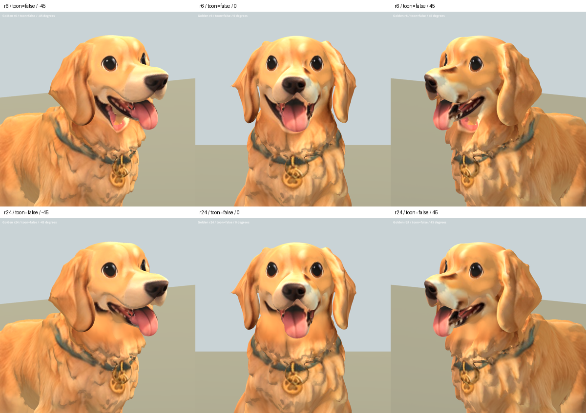

# 黃金獵犬下顎貼圖 r24 — 2026-10-06

REVIEW / B。依主人要求跳過柴犬，轉向對手黃金獵犬。以原 r6 為基礎，
僅清理真正舌頭下方、下顎／頸前的重複嘴形與粉紅舌頭投影。
使用主人既有 `references/dogs/golden_front.png` 的頰毛區域，沿三維位置
限定投影範圍。第一輪範圍过高覆蓋了真實口腔，已撤回並下移。

原本長口鼻、垂耳、頭型與開口保留。鼻口色塊、嘴角碎面、頸部毛簇破碎感
及既有 Sit 問題尚未修復；不能當作整隻已達最終品質。遊戲版本未更新。

## 資料與交付

- 原始備份：`assets/art_previews/dogs/candidates/r24/golden_r6.glb`。
- 候選：`assets/art_previews/dogs/candidates/r24/golden.glb`。
- 來源 SHA256：`0a214fe0a729576e685d5aa2f3747957945c269c39f00a39cf86d3d6a651672e`。
- 候選 SHA256：`8b5cd05a9de0a203ce5a6f74929663f6bba15840dc109f1896133c6892e5b93b`。
- 量測原模型高度 0.75 m，按此品種獨立設定修復位置。
- 原二進位資料全部保留，mesh/accessor/nodes/skins/animations/materials/
  textures/samplers/scenes JSON 相同，只追加替換 base-color PNG。
- 幾何、UV、拓撲、法線、權重、骨架及動畫完全未動；整张 atlas 烘焙重新
  取樣，不能宣稱修改區外像素完全一致。
- 沒有新增第三方素材；沿用 breed factory / inherited rig 授權限制。

工具：`tools/art/bake_golden_r24.py`、`package_golden_r24.py`、
`validate_golden_r24.py`、`verify_golden_r24.ps1`、`contact_golden_r24.py`。
數據及原始渲染：`build/golden_face_r24/`。Blender 原檔備份與材質里程碑
位於 TEMP 的 `golden_r24_*.blend`。

## 比較

2026-10-07 完成最終 Godot 驗證。29 張擷取涵蓋兩材質五角度前後、
Idle/Walk/Sit 各三時點，程序退出碼 0、stderr 空白。已檢視正斜面、側面及
動畫總覽。修正美術擷取腳本：隱藏背景犬種標牌，動畫鏡頭依模型高度取景；
重拍後完整包含黃金獵犬頭部。Sit 既有抬腿／軀幹變形仍明顯，未宣稱通過
動作品質驗收。下顎重複嘴形清除，但補毛區偏平、嘴角碎面仍待處理。

上排原 r6，下排 r24。

[左右側面](golden_r24_2026-10-06/sides_false.png) ·
[動畫](golden_r24_2026-10-06/animations.png)
