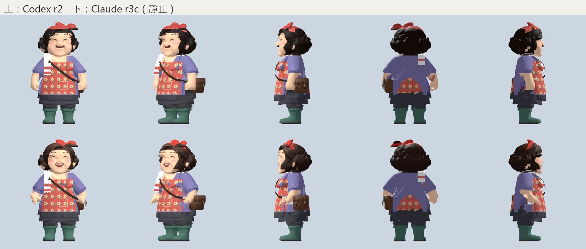
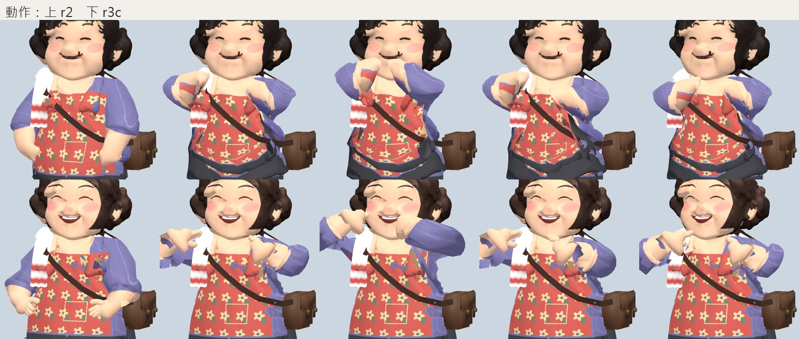
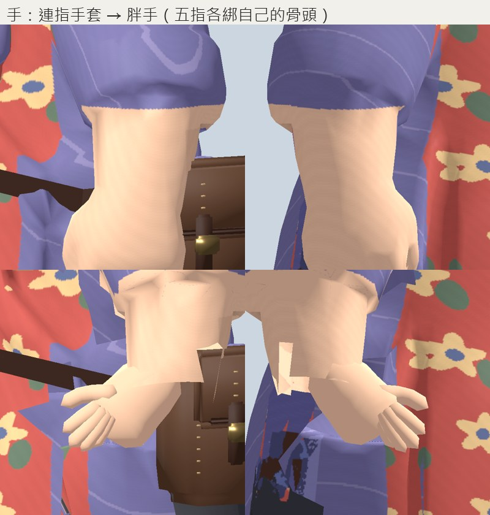
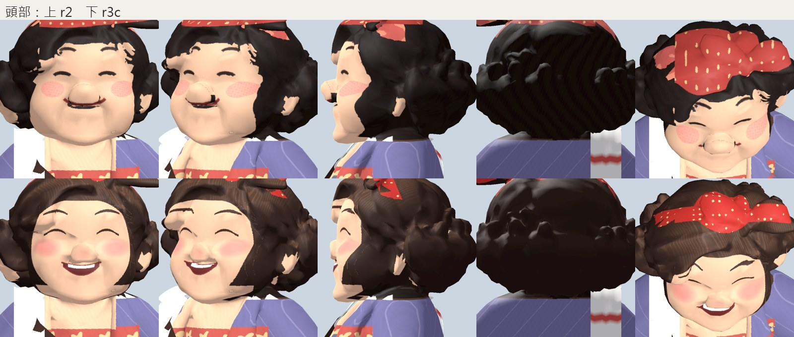
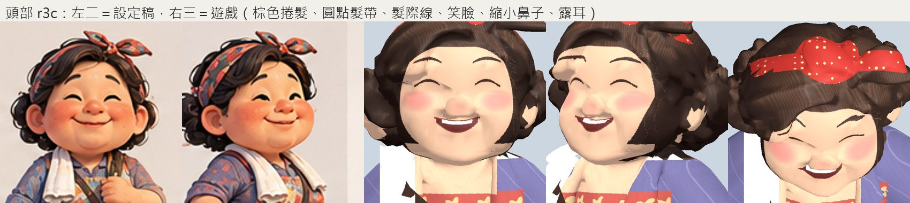

# Market auntie r3 — 2026-10-15 (Claude)

Owner: 「Codex 做完了，接手阿姨」. Built on Codex's r2 checkpoint
(`build/market_auntie_refine_r2/04_skin_refined.blend`): his satchel, strap, bandana,
apron, towel and r2 weights are kept. **Installed** to
`assets/characters/human/models/market_auntie/market_auntie.glb` (candidate copy:
`assets/art_previews/humans/market_auntie_r3/market_auntie_wip.glb`). Grade B+: clearly
better than r2 in the hands, raised-arm poses and hair, not final art.

All review captures are Godot (`tools/art/capture_auntie_r3.gd`): rest-pose views, head /
hand / shoulder close-ups, three frames of all 19 clips, chest close-ups of Idle, Block, Jab,
Walk_Relaxed and HeavyHook. Top row r2, bottom row r3.






## What changed

| Problem (r2) | Cause | r3 |
|---|---|---|
| Mitten hands | generator geometry; the rig's hand bones sat ~7 cm above the visible fist | Hand and finger bones moved to the mesh wrist (fingers shortened ×0.78, drawn together: chubby). Mitten cut by a plane at the wrist; new hands built on the bones: palm from the measured wrist section, one tube per finger, each segment skinned 1:1 to its bone (fists close in the fight clips). Colour from a skin texel, no extra material. Weapons attach to `hand_*` + grip, so held items now sit in the visible palm. |
| Strips of blouse/skirt stretching to a raised arm (Block, Jab, HeavyHook), skirt flaring dark | arm and torso were one surface from armpit to wrist, and torso vertices carried arm weight | Below the armpit (shoulder joint − 7.5 cm): faces joining arm and body removed, openings closed, arm weights dropped from torso vertices and torso weights from arm vertices (450 + 557). Old mitten flaps past the wrist removed. |
| Towel red and sleeve purple painted on the bare forearms | projection | Forearm faces below the elbow: non-skin texels → sheet skin. |
| Ears and specks skin-coloured inside the hair (sheet: curls cover the ears) | projection | Head/neck faces above the chin: skin islands under 80 faces and skin texels mostly surrounded by hair (side/back only) → hair colour. Only skin→hair: the drawn face is never touched. |
| Mouth stroke projected onto the side of the nose | front projection on a protruding nose | Dark texels on the nose's side walls → skin. |

### r3b — the problems left after r3 (owner: 「你有遇到問題，想方法解決」)

| Problem left in r3 | Cause found | Fix |
|---|---|---|
| Apron top corners (the red "bow") rode the shoulder in guard poses | those chest vertices carried 50–100 % upper-arm weight | apron vertices (by texel: not purple / skin / hair, on the front of the chest) give their arm weight to `spine_03` (266 vertices) |
| Sleeve broke into purple shards on a bent arm; zigzag hem | the owner-fitted elbow sat at 38 % of her arm, inside the sleeve (hem at ~65 %) | elbow joint moved to 60 % of shoulder→wrist; every arm vertex below the armpit re-weighted along the chain (upper arm / forearm blend ±3 cm at the elbow, forearm / hand at the wrist); straight hem found per texel along the arm |
| Forearms patchy (darker blotches) | projection's baked shading | forearm below the hem is flat sheet skin |
| Hands looked tiny on thick forearms | finger radius from an average hand | fingers ~1.3× thicker, hand 12.5 cm |

### r3c — the head (owner: 「頭還是需要改」)



`tools/art/auntie_r3_head.py`: every head texel gets its rest-pose 3D point and normal, so
the head is redrawn as shapes in the mesh's own front coordinates (measured on a front grid:
brows z 1.33, eyes 1.24, mouth 1.13, chin 1.03, hairline 1.345).

| Sheet | r3b | r3c |
|---|---|---|
| dark brown curly bob, lighter curls | near-black flat shell | sheet brown; lighter where the shell's lumps face an up-front light, thin strands |
| clean rounded hairline | jagged, dark strokes on the forehead | hairline arch, flat skin below it |
| headband: a band over the crown + knot | red cap over the whole crown, dots grown into blotches | band (plane through the crown and above the ears, 6 cm) + knot only; flat red with even cream dots on a 3D lattice |
| small button nose | 11 cm bulb, 4 cm out | front part keeps 35 % of its depth, drawn in (62 vertices) |
| happy closed eyes, thin arched brows, wide smile, rosy cheeks | old projected strokes, thin flat mouth | redrawn: arched brows, ∩ eyes with a lash, open smile with teeth, soft blush, pink nose tip |
| ears visible | painted hair in r3 | ear islands (cheek height) skin again |

Still open: hair geometry is one lumpy shell (a few dark strokes on the forehead read as
curls); the sheet's basket, spatula and pan are not modelled (the spatula is her weapon on
the sheet — gameplay scope, P-05).

## Rebuild

```bash
B="/c/Program Files/Blender Foundation/Blender 5.2/blender.exe"; K=build/market_auntie_r3
"$B" -b --factory-startup --python tools/art/auntie_r3_hands.py -- build/market_auntie_refine_r2/04_skin_refined.blend $K/01_hands.blend
"$B" -b --factory-startup --python tools/art/auntie_r3_arms.py  -- $K/01_hands.blend $K/02_arms.blend
"$B" -b --factory-startup --python tools/art/auntie_r3_paint.py -- $K/02_arms.blend $K/03_paint.blend $K/market_auntie_r3_basecolor.png
"$B" -b --factory-startup --python tools/art/auntie_r3_head.py  -- $K/03_paint.blend $K/04_head.blend $K/market_auntie_r3_basecolor_head.png
"$B" -b --factory-startup --python tools/art/auntie_r3_export.py -- $K/04_head.blend assets/art_previews/humans/market_auntie_r3/market_auntie_wip.glb
godot --path . --resolution 640x640 --script res://tools/art/capture_auntie_r3.gd -- res://assets/art_previews/humans/market_auntie_r3/market_auntie_wip.glb <out> r3
```

Each step writes a JSON report next to its .blend (`*_hands.json`, `*_arms.json`,
`*_paint.json`); the numbers are also in the GLB's `.provenance.json`.

Start from the .blend, not the GLB: a mesh re-imported from the GLB exports the towel's
colour attribute as plain white (Blender 5.2 glTF; LESSONS 6.18).
