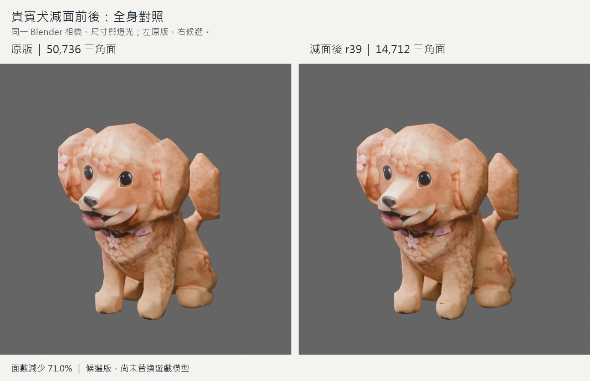
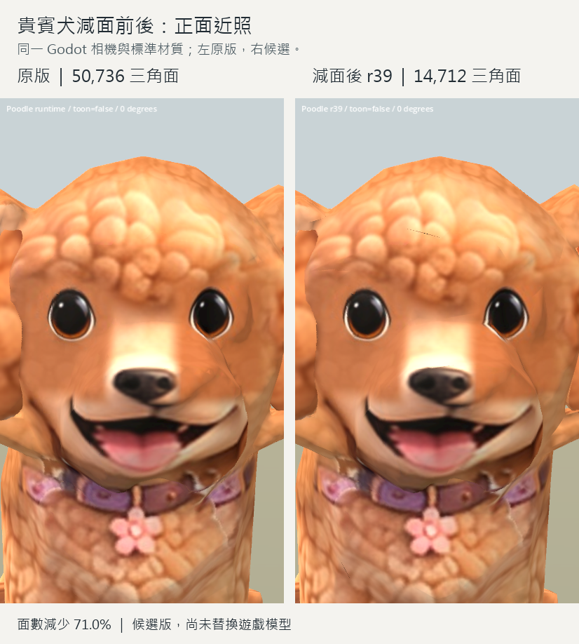
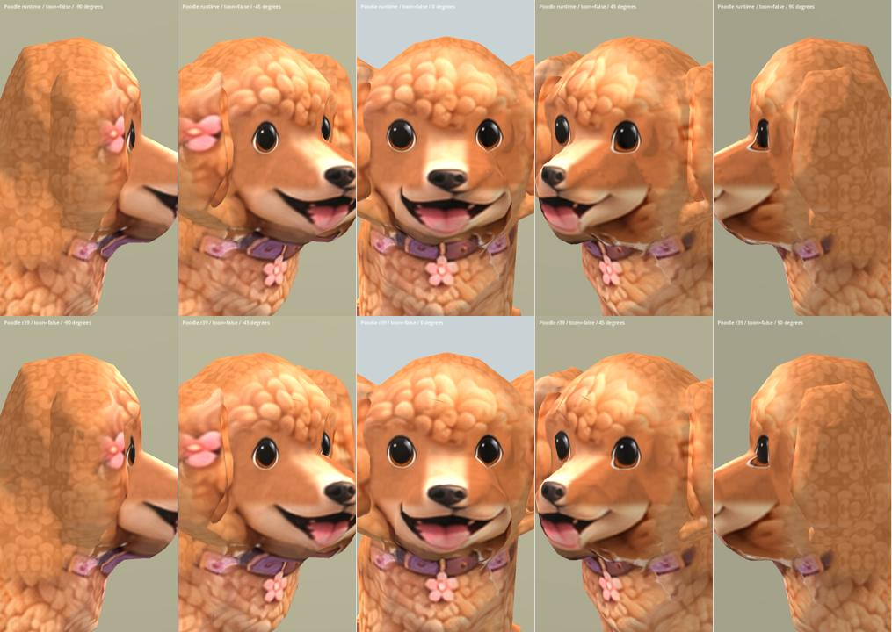

# Poodle budget r39 — 2026-10-14

Status: REVIEW / B candidate. CX-07 budget target reached in a separate asset;
production acceptance remains open. Runtime poodle is unchanged.

## Direct before / after comparison

Left: original 50,736 triangles. Right: r39 14,712 triangles. Each pair uses
the same camera and image dimensions.

## Result

Reduced 50,736 to **14,712 triangles** (71.0%). The original 23-joint skeleton,
inverse bind matrices, node hierarchy and Idle/Sit/Walk animation descriptors
and binary data are retained. Geometry, UVs and interpolated skin weights change.
Eight influences remain supported; no new jaw or animation is introduced.

Candidate: `assets/art_previews/dogs/candidates/r39/poodle.glb`.
Source: `assets/characters/dog/models/breeds/poodle.glb` (r28 appearance with
published r33 skin). Matching runtime Mesh2Motion library was used for comparison.

## Method and review

Weld coincident physical vertices before reduction while retaining corner UVs.
Use weighted collapse with strong UV-boundary protection, then unwrap the reduced
mesh and bake the original surface appearance into a new 2048 px albedo. Reset
stale split normals and sharp flags. Package only the new mesh/material data over
the unchanged source skeleton and animations.

The unwelded trial cracked visibly. Welding removed the large cracks, but reusing
interpolated original UVs distorted eye edges and the nose. That trial was also
rejected. The source-to-target bake restores those features in the final candidate.
This is a budget study with repaired shading/UVs, **not certified production
retopology**. It does not establish S-level art.

Observed remaining limitations:

- Raised ear-fill edges, coarse tail and body silhouette, and inherited muzzle/
  neck material transitions remain.
- Fine dark seam marks remain in some close views (forehead/body). The new bake
  also slightly softens detail; it needs further seam and texture finishing.
- Existing seated/folded limb shapes remain weak. Some low-resolution skin
  silhouettes differ in the sampled motion comparisons; dense surface-deformation
  validation is still required before publishing.
- Original Sit is visibly awkward. Bark/Howl still lack a skinned jaw.
- The candidate retains the original binary prefix for auditability. File-size
  optimization is not claimed; unused old mesh/image data should be stripped only
  after acceptance, with preservation checks rerun.

## Evidence

Godot **4.6.3** imported the candidate successfully. The existing
`breed_models_test._check_model` helper passed **10 candidate-specific checks**
(load, skeleton, three clips, color, triangle sanity, height, ground and facing).
A separate binary audit verifies 14,712 triangles, valid joint indices, finite
positions and normalized weights (maximum sum error 4.75e-8).
Height is 0.45007 m; minimum Y is 0.000039 m.

**119 final Godot captures were reviewed via the linked sheets:** 20 static views
(two models, five angles, two materials), nine original-clip samples, and 90
Mesh2Motion comparisons (two models × nine clips × five times). These are sampled
ART checks, not independent blind QA or a dense all-frame deformation certificate.
No full runtime regression or runtime-publish claim is made.

Top row is runtime baseline; bottom row is r39 in paired sheets.

[SoftToon faces](poodle_budget_r39_2026-10-14/faces_toon.jpg) ·
[Blender neutral](poodle_budget_r39_2026-10-14/blender_comparison.jpg) ·
[Original clips](poodle_budget_r39_2026-10-14/original_clips.jpg)

Motion comparisons:
[Idle](poodle_budget_r39_2026-10-14/motion_Idle.jpg),
[Run](poodle_budget_r39_2026-10-14/motion_Run.jpg),
[Fetch](poodle_budget_r39_2026-10-14/motion_Fetch.jpg),
[Bark](poodle_budget_r39_2026-10-14/motion_Bark.jpg),
[Alert](poodle_budget_r39_2026-10-14/motion_Alert.jpg),
[Sneak](poodle_budget_r39_2026-10-14/motion_Sneak.jpg),
[Jump](poodle_budget_r39_2026-10-14/motion_Jump.jpg),
[Howl](poodle_budget_r39_2026-10-14/motion_Howl.jpg),
[Sit](poodle_budget_r39_2026-10-14/motion_Sit.jpg).

## Rebuild and checkpoints

Scripts, in order: `tools/art/build_poodle_budget_r39.py`,
`bake_poodle_budget_r39.py`, `package_poodle_budget_r39.py`.
Run in Blender 5.2 with the original imported, unposed `DogBody` and its rig.
For this iteration restore `build/poodle_budget_r39/poodle_01_review.blend` first.
The build script asserts the original triangle count to reject an accidental
second reduction. The bake script expects the review checkpoint there.
Packed editable final checkpoint:
`build/poodle_budget_r39/poodle_06_packaged.blend` (ignored local intermediate).
The previous live Blender scene was saved as `session_before.blend` before import.

Captures: existing `capture_pomeranian_r9.gd` with candidate/baseline arguments;
`tools/art/capture_poodle_budget_r39.gd` for nine runtime motion clips;
`python tools/art/contact_poodle_budget_r39.py` for sheets.
Numerical evidence: [verification.json](poodle_budget_r39_2026-10-14/verification.json).

Source SHA-256: `dde998aa796f129a1f3616a52e2bccbb20b1431a39e2ddc6b3589a65486ec12d`.
Candidate SHA-256: `617acaffe0178404832dc167e10ccc0510d96ad5e31c0a3515dbde331e3b528c`.

## Provenance

Project-authored reduction and rebake of the existing poodle. No download, new
third-party image, plugin installation or reference replacement. Existing factory
reference/model rights and Mesh2Motion provenance remain unchanged; originals
are retained. See ASSET_LICENSES.md.
