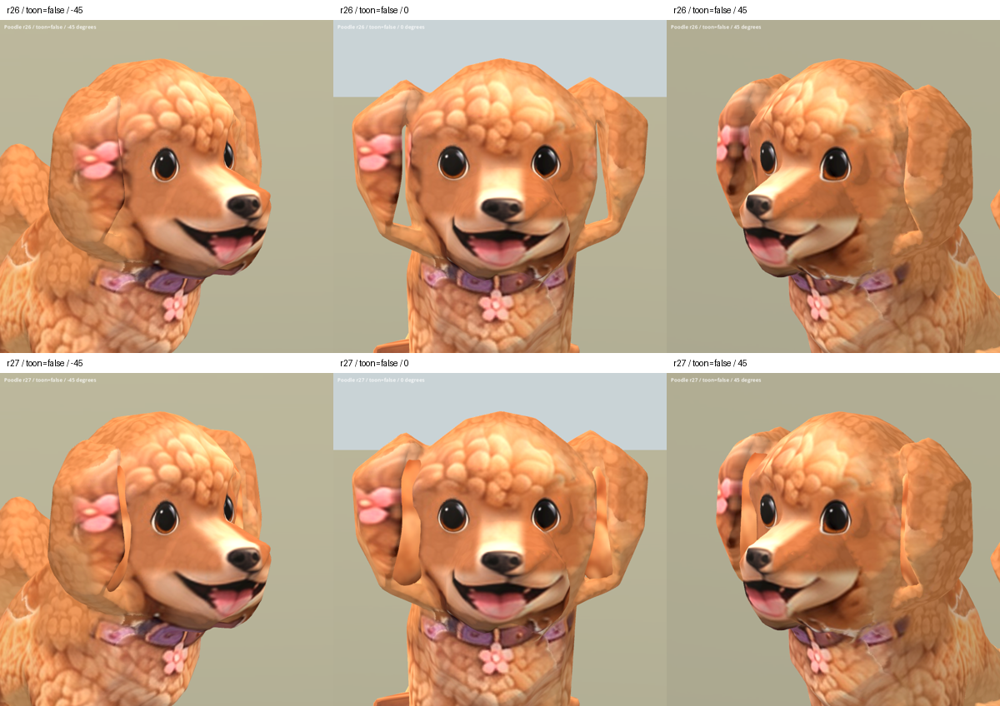

# Poodle ear infill r27 — 2026-10-08

Status: REVIEW / B. Separate preview candidate; runtime unchanged.

Two fitted skinned volumes cover the background-visible openings between the head and original loop-like ears. The final wider revision also covers the small lower gaps in the inspected front view. Side silhouettes remain substantially unchanged. This is an occlusion repair, not welded retopology: original ear geometry remains underneath.

Smooth orange strips and material/shape transitions remain visible. Curl detail does not match the surrounding ears sufficiently for final art. Existing muzzle seams, coarse fur, body defects and raised front paws in Sit remain. Not S-level or approved final art.

Candidate: `assets/art_previews/dogs/candidates/r27/poodle.glb`.
Baseline: `assets/art_previews/dogs/candidates/r26/poodle.glb`.

## Construction

- Original r26 binary prefix, mesh primitive, nodes, skin and animation data retained.
- Two added primitives: 1,220 vertices and 2,432 triangles; 50,736 total triangles, above the production dog budget.
- Weights transferred from four nearby original vertices, limited to four influences and normalized; existing bone indices reused.
- Fur comes from the owner's existing factory `references/dogs/poodle_front.png`. No new third-party source; inherited factory/Hunyuan/rig restrictions remain.
- One material and embedded reference image appended. Existing textures, UVs and materials retained. Added surfaces/material increase rendering cost.

Reproduction: `tools/art/build_poodle_r27.py` (Blender), `package_poodle_r27.py`, `verify_poodle_r27.ps1`, `contact_poodle_r27.py`.
Blender snapshots in the system temporary directory: `poodle_r27_00_before.blend` (original pre-edit state), `poodle_r27_02_ear_volume.blend` (final infills). These are temporary intermediates; the scripts and retained r26 input reproduce the candidate.

## Validation

Final Godot import/capture exited 0 on 2026-10-08: 20 static views (two versions, standard/SoftToon, five angles) and nine animation samples (Idle/Walk/Sit at 25%, 50%, 75%). All captured angles and animation samples inspected. No visible infill detachment in these samples; this is not exhaustive validation of every frame or extreme ear pose. Blender front and both oblique views also inspected.

Earlier iteration had excessive upper protrusion and flower contamination; final volume is shorter and samples fur only. A lower gap in the second iteration prompted the final wider infill.

Packaging checks: original binary prefix/mesh primitive and scene/rig/clip descriptors preserved; normalized weights, valid indices, finite positions and nondegenerate added triangles. Evidence: `build/poodle_ears_r27/verification.json`, `import.log`, `capture.log`, `capture_stderr.log`. An earlier sandbox capture crashed after failing to open the user log; final authorized rerun succeeded.

Source SHA256: `a69ab9d85b2c1d5f313583e1ab7a5b9df1c590833ffa7557774714bbf8d20407`.
Candidate SHA256: `e0789cbc8bfd00080c515bcff974b1578b8564e01d150fcee699e9057f728e39`.

[Side comparison](poodle_r27_2026-10-08/sides_false.png) · [SoftToon angles](poodle_r27_2026-10-08/all_true.png) · [Animation samples](poodle_r27_2026-10-08/animations.png)

Next art work: integrate ear surfaces with coherent curls and continuous transitions. This local infill does not resolve overall character quality.
