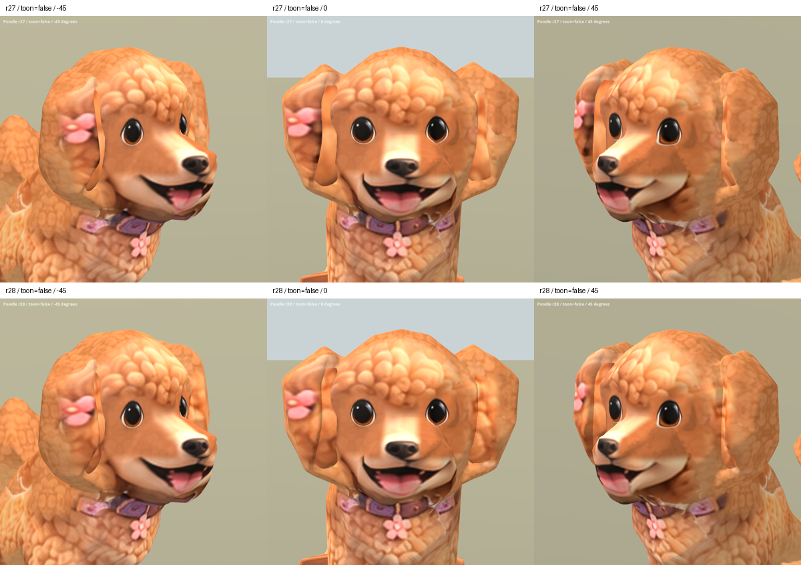

# Poodle ear material r28 — 2026-10-08

Status: REVIEW / B. Separate preview candidate; runtime unchanged.

## Result

A shared local front-reference projection adds visible curl detail to the r27 ear infills and blends that projection into adjacent original ear surfaces. The original left flower is protected by a local mask. Compared with r27, the flat orange strips are less uniform, particularly on the right ear. The background openings remain covered in the inspected views.

The raised infill boundary and dark geometric fold remain visible, especially on the left. Curl scale and color transitions still differ across parts of the ear. This material pass improves the strips but does not resolve the underlying overlapping geometry or achieve final-art quality. Muzzle seams, coarse body surfaces and the inherited Sit pose remain.

Candidate: `assets/art_previews/dogs/candidates/r28/poodle.glb`.
Baseline: `assets/art_previews/dogs/candidates/r27/poodle.glb`.

## Preservation and provenance

Geometry, normals, triangle indices, weights, bones, inverse bind matrices and animation data remain byte-identical to r27. The two infill primitives receive revised UV coordinates. The body image is replaced with a 2048 px Blender emission bake; the whole atlas is rebaked, so pixels outside the local edit can be resampled rather than byte-identical. Total remains 50,736 triangles, above the production dog target. Existing materials and texture descriptors are retained.

Input is the owner's existing factory `references/dogs/poodle_front.png`; no new third-party source. Inherited factory/Hunyuan/rig restrictions remain.

Scripts: `tools/art/material_poodle_r28.py`, `bake_poodle_r28.py`, `package_poodle_r28.py`, `verify_poodle_r28.ps1`, `contact_poodle_r28.py`. Material setup expects the existing r27 Blender working scene with `DogBody` and `EarFill_R27` objects. Restore the pre-material snapshot before repeating setup to avoid stacking material changes. Temporary snapshots: `poodle_r28_00_before.blend`, `poodle_r28_01_projection.blend`, `poodle_r28_02_baked.blend` in the system temporary directory.

## Validation

Godot import and capture exited 0. Inspected 20 static comparison captures (r27/r28, standard/SoftToon, front, both obliques and both profiles) and nine Idle/Walk/Sit samples at 25%, 50%, 75%. No new visible infill separation in these sampled poses. This does not certify every animation frame. Blender material preview was also inspected.

Packaging verifies every original binary byte outside the infill UV ranges is retained, and mesh/node/skin/animation/material/texture/sampler/scene descriptors remain unchanged. Evidence: `build/poodle_ears_r28/verification.json`, `import.log`, `capture.log`, and `capture_stderr.log`.

Source SHA256: `e0789cbc8bfd00080c515bcff974b1578b8564e01d150fcee699e9057f728e39`.
Candidate SHA256: `5f2acb9bdfad2f8998dbdc3bbec8835bd2dbd51e243957ebe10487426192e560`.

[Side comparison](poodle_r28_2026-10-08/sides_false.png) · [SoftToon angles](poodle_r28_2026-10-08/all_true.png) · [Animation samples](poodle_r28_2026-10-08/animations.png)

Next substantive repair: integrate the ear geometry to remove the raised infill edge, followed by coherent UV/material work. Additional color edits alone cannot remove this fold.
