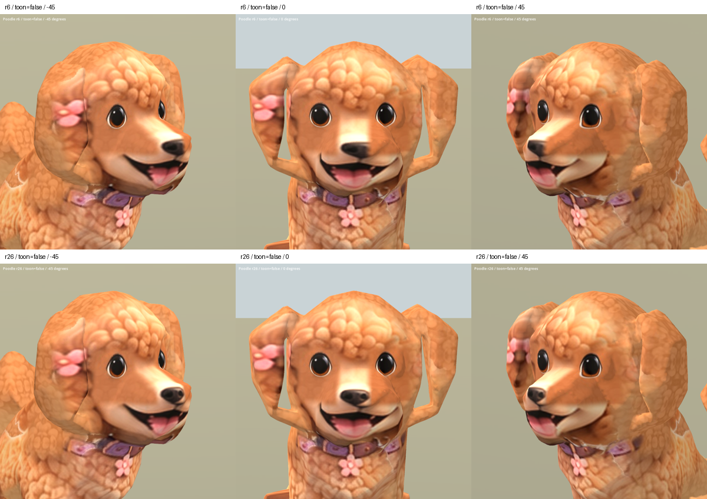

# Poodle nose material r26 ? 2026-10-07

Status: REVIEW / B. Preview candidate only; runtime unchanged.

Localized front-reference projection registers a continuous nose over original
r6 geometry. The frontal black nose is rounder and less split; the muzzle,
ear openings and facial seams are still inherited defects. This is a small
material improvement, not a production-ready dog.

Candidate: `assets/art_previews/dogs/candidates/r26/poodle.glb`.
Baseline: adjacent `poodle_r6.glb` copied from runtime.
Input reference: owner's existing factory `references/dogs/poodle_front.png`.
No new third-party source; existing factory/Hunyuan/rig restrictions remain.
The full atlas is rebaked at 2048px, so pixels outside the local edit may be
resampled rather than byte-identical.

Validation: original binary prefix and mesh/accessor/node/skin/animation/
material/texture/sampler/scene JSON retained exactly; only embedded base-color
image replaced. See `build/poodle_face_r26/validation.json` and verification.json.
Godot import and capture exited 0: 20 static views and nine animation samples.
Inspected Blender front/45-degree, Godot front/oblique comparison, all toon
angles and Idle/Walk/Sit samples. Sit still raises front paws unnaturally;
ear loops, muzzle seams and coarse fur remain. Animation data was not modified.

Source SHA256: fb7ebff37517697799a6114b76350ceaabf546e095bc3785c758850543fa256e
Candidate SHA256: a69ab9d85b2c1d5f313583e1ab7a5b9df1c590833ffa7557774714bbf8d20407

[Toon all angles](poodle_r26_2026-10-07/all_true.png)
[Animation samples](poodle_r26_2026-10-07/animations.png)
