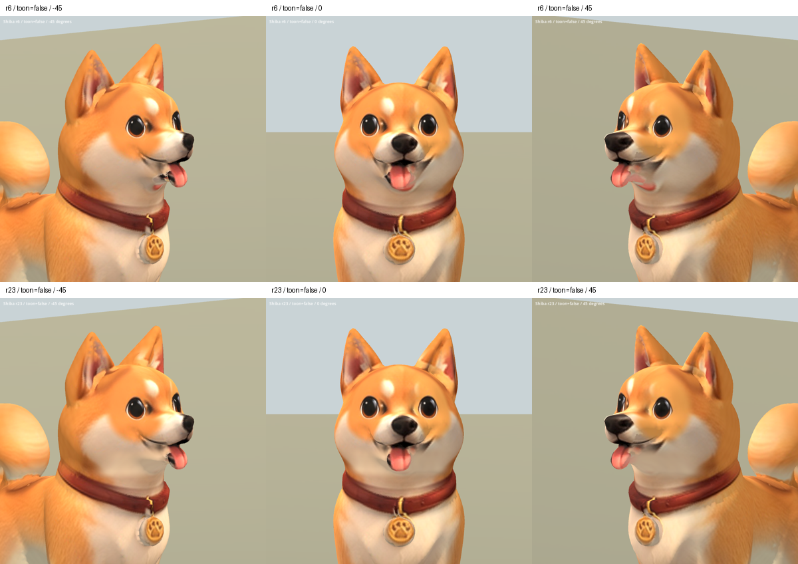

# 柴犬下巴貼圖 r23 — 2026-10-06

REVIEW / B。依主人要求轉換犬種，處理對手柴犬 `breeds/shiba.glb`，
不是玩家的 `shiba_01`。保留原 r6 頭型與五官，局部減淡真正舌頭後方、
下巴上的重複舌頭投影。

使用原有柴犬正面設定圖的淺色頰毛投影，依柴犬 0.55 m 高度及嘴部位置
獨立設定範圍。第一輪塗補過高、遮到真實嘴部開口，已撤回；最終縮至
較低的下巴範圍，保留上方原笑嘴。嘴角仍有灰黑殘邊與不自然的接面，
鼻頭貼圖、耳內表面及既有 Sit 變形均未修復。不宣稱整臉已完成。

## 資料與來源

原始來源保存：`assets/art_previews/dogs/candidates/r23/shiba_r6.glb`。
候選：`assets/art_previews/dogs/candidates/r23/shiba.glb`。
來源 SHA256：`6950459c8e9594ff723f77f47d6aa553eebe84baa22f10d6bcd2159517a1d1c1`。
候選 SHA256：`6700eebcd23e38ac91cfca177e5575cb68f03e056be422444233d7a6db1b30d7`。

驗證：所有原 GLB 二進位資料保留，mesh/accessor、UV、拓撲、法線、骨架、
權重、動畫相關 JSON 一致。只追加替換 base-color PNG。整張 atlas 重新
烘焙至 2048²，不能宣稱修改區外像素完全不變。遊戲兩種柴犬路徑均未更新。

無新增第三方素材；使用主人既有 `references/dogs/shiba_front.png`，保留
breed factory / inherited rig 授權限制。Blender 備份位於 TEMP
`shiba_r23_00_original.blend`，另有材質與烘焙里程碑。

工具：`tools/art/bake_shiba_r23.py`、`package_shiba_r23.py`、
`validate_shiba_r23.py`、`verify_shiba_r23.ps1`、`contact_shiba_r23.py`。
原始渲染、檢查及擷取日誌：`build/shiba_face_r23/`。

## 比較

Blender 五角度渲染完成，實際查看正面、斜側及側面。Godot 最終擷取 29 張
（两材質五角度前後、三動作各三時點），退出碼 0；已查看一般材質正斜面、
左右側面及動畫總覽。動畫鏡頭上緣裁到部分耳尖，Sit 後段裁到頭部，故不
視為完整頭部動態驗收。下巴粉紅殘影減少，但淺色過渡偏平，嘴角殘邊仍在。

上排 r6，下排 r23。

[側面](shiba_r23_2026-10-06/sides_false.png) ·
[動畫](shiba_r23_2026-10-06/animations.png)
